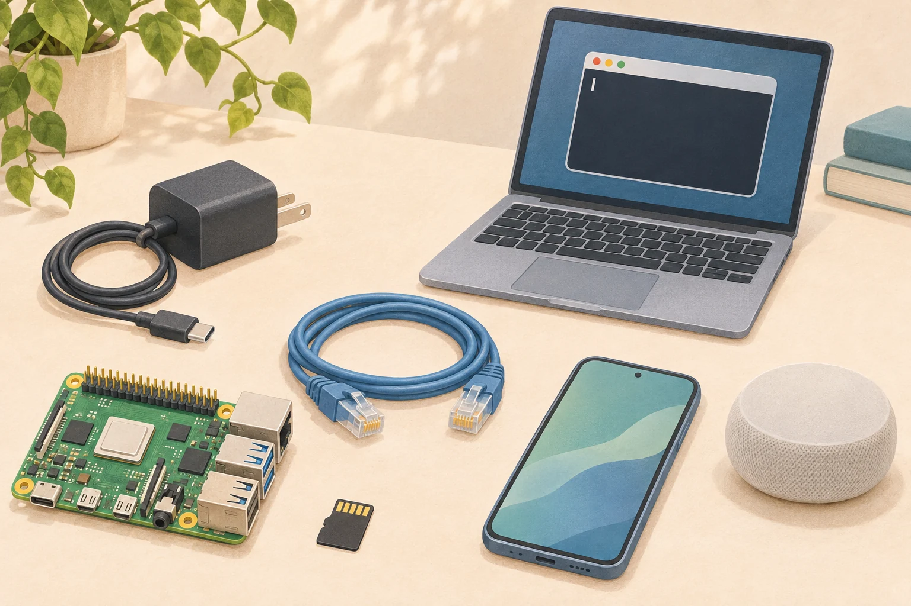
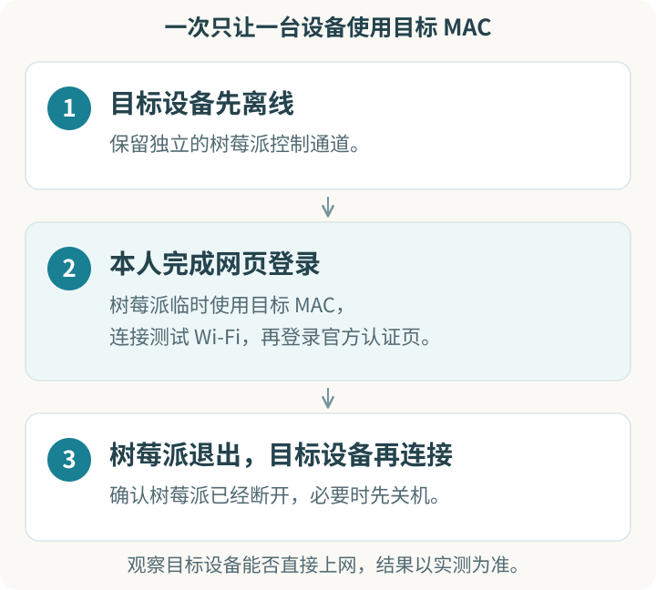

在学校宿舍、酒店或统一供网的公寓里，你可能遇到过这样的情况：手机连上 Wi-Fi 后，打开网页输入账号或验证码，就能上网；智能设备虽然也连上了 Wi-Fi，却没有地方打开这个登录网页。这个额外的网页，就是常说的 **Portal 认证页**。

本文讨论一次兼容性实验：让树莓派临时使用目标设备的无线网卡地址（MAC），由本人完成网页登录；树莓派退出后，再看目标设备能否直接上网。

> 仅用于本人设备、本人账号，并须得到网络管理方许可。脚本已有离线检查，实际 MAC 切换、Portal 登录和设备能否继承认证仍待实机验证。

[项目源码](https://github.com/Xplore-LAB/portal-mac-experiment) · [下载实验包 v0.3.2](https://github.com/Xplore-LAB/portal-mac-experiment/releases/download/v0.3.2/portal-mac-experiment-v0.3.2.zip) · [完整技术教程](https://github.com/Xplore-LAB/portal-mac-experiment/blob/v0.3.2/TUTORIAL.md)

<style>
.post-container .portal-figure { margin: 30px 0; }
.post-container .portal-figure img { width: 100%; height: auto; margin: 0 auto; border-radius: 12px; }
.post-container .portal-figure figcaption { margin-top: 10px; color: #6a737d; font-size: 14px; line-height: 1.65; text-align: center; }
.post-container .portal-figure--steps { max-width: 640px; margin-left: auto; margin-right: auto; }
.post-container table { display: table; table-layout: fixed; width: 100%; }
.post-container table th, .post-container table td { white-space: normal; overflow-wrap: anywhere; vertical-align: top; }
</style>

## 一、哪些设备和场景会遇到？

“无屏智能设备”就在日常生活里，例如：

- **智能音箱：** 听在线音乐、查天气、语音问答，通常通过手机 App 设置 Wi-Fi。
- **Wi-Fi 摄像头：** 例如室内或宠物摄像头，联网后使用相应的远程查看功能。
- **扫地机器人：** 通过厂商 App 远程操作、查看清扫记录。
- **直接连接 Wi-Fi 的智能插座、灯泡等：** 通过手机 App 设置和使用联网功能。

它们的共同点是：**能使用网络，却未必有浏览器完成上网认证。** 有些产品带小显示屏，但无法打开网页，也可能遇到同样的问题。具体型号是否适用仍要单独确认；只使用蓝牙、或通过网关连接的产品，应按实际联网方式判断。

常见场景包括**校园宿舍、长租公寓和员工宿舍、酒店或民宿**：网络可能要求输入学号、手机号、房号或确认条款。经场地方许可的**共享办公、临时展台**也可能遇到类似问题，演示设备接入访客 Wi-Fi 时尤其常见。

当前脚本针对的是**Wi-Fi 本身无需密码即可连接，随后再通过网页认证**的网络。先输入 Wi-Fi 密码的网络，以及 802.1X / WPA-Enterprise 网络，不在本版支持范围。还应核对设备支持的频段，例如目标网络是否提供它能使用的 2.4 GHz 或 5 GHz。

如果学校或场地方已有“智能设备登记”“物联网专网”，或设备 App 自带酒店、校园网络连接功能，先使用正式入口。可以参考[高校设备登记示例](https://it.cornell.edu/wifi/register-device-doesnt-have-browser)和[设备官方接入示例](https://support.apple.com/guide/homepod/set-up-homepod-apd779d9bb45/homepod)。

## 二、准备好物品和操作通道

需要准备的东西并不复杂：

- **目标智能设备及其电源**，并查到它实际使用的 Wi-Fi MAC。
- **能正常启动的树莓派**，包含 Wi-Fi、电源和已装系统的存储介质。系统需使用 NetworkManager，也就是后文 `nmcli` 命令对应的网络管理工具。
- **手机和设备配套 App（按需）**，用于给设备选择 Wi-Fi、查看设备信息。
- **一种稳定的树莓派操作方式**，以及目标 Wi-Fi 名称（SSID）和本人的网页登录资料。

<figure class="portal-figure">
  
  <figcaption>准备物品示意。电脑和网线用于远程操作；也可以改用本地显示器与键盘。AI 生成插图。</figcaption>
</figure>

**在树莓派旁操作：** 接显示器和键盘，使用图形桌面时配鼠标，在树莓派本机终端运行脚本即可。

**在电脑上操作：** 用独立网线连接电脑和树莓派，通过 SSH 控制。本文以 Windows 为例。**管理连接必须在树莓派切换 Wi-Fi 时继续可用**；只通过准备修改的那张 Wi-Fi 网卡维持 SSH，脚本会拒绝继续。

Windows 网线直连可采用 `192.168.88.1/24`（电脑）和 `192.168.88.2/24`（树莓派），管理网线不设置默认网关；先确认该网段与现有网络不冲突。通过树莓派已有的另一条控制途径，按[连接指南](https://github.com/Xplore-LAB/portal-mac-experiment/blob/v0.3.2/docs/connection-methods.md)完成配置，确认能执行下面的命令后再开始实验：

```powershell
ssh myuser@192.168.88.2
```

`myuser` 换成你在安装系统时设置的用户名。新装系统可用 Raspberry Pi Imager 预设用户和 SSH；写入镜像会清空存储卡，已有系统请先确认和备份。想在 Windows 上操作树莓派桌面，可以在带桌面的系统中配置 VNC，并通过有线管理地址连接；具体步骤也在连接指南里。

## 三、按顺序做一次实验

整个过程最重要的是顺序：目标设备先离线，由树莓派完成测试，再让树莓派退出，最后才启动目标设备。

<figure class="portal-figure portal-figure--steps">
  
  <figcaption>操作顺序图。两台设备应避免同时使用同一个 MAC；最后一步的联网效果需要实测。</figcaption>
</figure>

**先查目标设备的 MAC，再让它完全离线。** 可以查看设备配套 App、私人路由器的设备列表，或让设备连接个人热点后查看已连接设备。MAC 形如 `aa:bb:cc:dd:ee:ff`，和 `192.168.1.20` 这样的 IP 地址不同。部分设备在不同 Wi-Fi 下会使用不同的随机 MAC，应尽量确认它在目标网络上实际使用的地址。

**下载并传到树莓派。** 有显示器时可以用 U 盘复制、解压；使用 SSH 时，在 Windows PowerShell 的 ZIP 所在目录运行：

```powershell
scp .\portal-mac-experiment-v0.3.2.zip myuser@192.168.88.2:
ssh myuser@192.168.88.2
```

**下面改在树莓派终端中运行，先检查再启动：**

```bash
unzip portal-mac-experiment-v0.3.2.zip
cd portal-mac-experiment
bash quick-start.sh --check
bash quick-start.sh
```

使用普通用户启动脚本，由它按需调用 `sudo nmcli`；不要在整段引导外再套 `sudo`，以免丢失 SSH 连接信息。默认无线接口是 `wlan0`，其他名称可使用 `WIFI_IF=wlan1 bash quick-start.sh`。

**按提示填写并本人登录。** 首次设置 Wi-Fi 名称，输入目标 MAC，完成必要的确认。脚本随后创建临时连接，核验实际 MAC、IPv4 地址和网络出口。有图形桌面时会尝试打开网页；确认是网络官方认证页后，再亲自输入账号、密码或验证码。

没有图形桌面时，需要先准备经网络管理方允许的认证方式，例如通过独立管理网络使用 VNC；纯 SSH 环境的可选浏览器通道见[连接指南](https://github.com/Xplore-LAB/portal-mac-experiment/blob/v0.3.2/docs/connection-methods.md)。无法完成认证时，先停在这里，不把“连上 Wi-Fi”当成“已能上网”。

**完成或放弃后，回到终端清理。** 按引导中的 Enter 停止测试连接并删除临时配置。中途报错时，可以手动运行：

```bash
bash scripts/portal-mac.sh restore
```

`restore` 会清理测试连接，**不保证网卡立即恢复原 MAC，也不会自动重连旧 Wi-Fi**。确认树莓派退出后，才让目标设备重新连接同一 Wi-Fi；不确定时，先将树莓派关机。临时 Wi-Fi 配置只驻留内存，NetworkManager 重启后会消失。

## 四、怎样判断结果、处理问题？

把下面几件事分别记录，才能知道实验停在哪一步：

| 观察到的结果 | 能说明什么 |
|---|---|
| 实际无线 MAC 与目标地址一致 | MAC 切换生效，尚不能说明已通过认证。 |
| 测试 Wi-Fi 已连接并取得 IPv4 地址 | 网络关联成功，可以继续核查出口和认证。 |
| 树莓派完成网页登录，且测试流量确实经测试 Wi-Fi 访问互联网 | 树莓派这次认证成功。 |
| 树莓派退出后，目标设备无需网页操作即可上网 | 本次设备认证继承成功。 |
| 目标设备重启后仍能上网 | 重启后的这次测试有效，认证期限仍由网络决定。 |

脚本只检查到 `1.1.1.1` 的 IPv4 路由。认证服务器、浏览器代理、VPN 和 IPv6 可能有不同路径，因此还要确认实际认证请求和测试流量走的是目标 Wi-Fi。

**Wi-Fi 切换后 SSH 断了：** 管理连接可能仍依赖待修改的无线接口。先建立本地终端或独立有线连接，再继续排查。

**树莓派能上网，目标设备仍不能：** 网络可能还绑定 IP、接入位置或会话。记录结果，再咨询网络管理方提供的设备接入方式；一次成功也不意味着认证永久有效。

**设备能上网，手机 App 却找不到它：** 访客网络可能让各台设备彼此不可见。设备发现、投屏和多设备联动需要另测，可参考[Google 官方排查说明](https://support.google.com/chromecast/answer/7566322?hl=en)。

用[结果模板](https://github.com/Xplore-LAB/portal-mac-experiment/blob/v0.3.2/experiments/result-template.yaml)保存脱敏后的观测。真实 MAC、个人地址、账号密码、Cookie 和 Token 均不要公开。快速入口只持久保存 SSID，运行时配置和终端输出仍可能包含 MAC、IP；浏览器也可能另行保存登录信息。

更多系统准备、VNC、逐条命令和手动恢复细节，见[完整教程](https://github.com/Xplore-LAB/portal-mac-experiment/blob/v0.3.2/TUTORIAL.md)。官方参考：[树莓派初始化](https://www.raspberrypi.com/documentation/computers/getting-started.html)、[SSH / VNC](https://www.raspberrypi.com/documentation/computers/remote-access.html)、[NetworkManager 命令](https://networkmanager.dev/docs/api/latest/nmcli.html)。

<p style="font-size:14px;color:#6a737d">封面与准备物品插图由 AI 生成；操作顺序图用于说明实验流程。</p>
